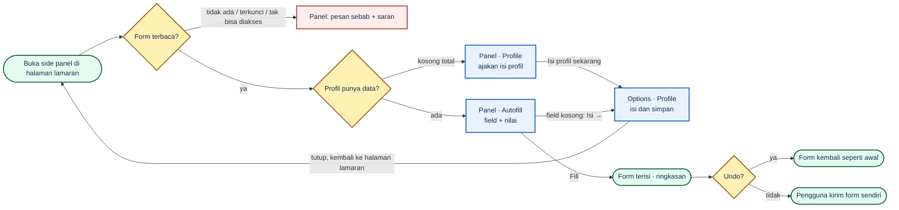

# PRD — job-kit

**Product:** job-kit — "Ketik sekali, lamar di mana saja."
**Type:** Chrome extension, Soft-UI card / bright-blue friendly, autofill lamaran kerja

**Sprint / Project:** Sprint ??? — job-kit
**Author (PIC):** imelda
**Builder:** imelda
**Date:** 2026-10-09
**Status:** APPROVED · **Revisi 2026-10-09 (DRAFT):** Lowongan harian (FR-26 sampai FR-33). Prinsip tanpa jaringan dan tanpa AI dicabut untuk fitur ini (keputusan PIC, §4.1).
**Research input:** `docs/01-research.md` (verdict BUILD)
**Launch date:** Day 10 — fixed

---

## 1. One-sentence test

job-kit membuat pelamar kerja mengisi form lamaran dengan satu klik dari profil yang ia ketik sekali, dan bisa membatalkannya.

**Revisi 2026-10-09:** job-kit juga mencarikan lowongan yang cocok setiap hari, memberi skor beserta alasannya, dan mengantar pengguna ke form lamarannya.

## 2. Problem & context

| | |
|---|---|
| **Persona** | Pelamar kerja yang lebih suka alat cepat dan jelas daripada alat yang bisa di-setting macam-macam. Melamar ke banyak tempat, tidak mau mengetik ulang. |
| **Not the target** | Recruiter, agency, orang yang mengelola profil banyak orang, power user yang ingin menulis aturan pemetaan sendiri. |
| **What goes wrong** | Data yang sama diketik ulang di tiap form. Autofill bawaan browser tidak mengenal field khas lamaran. |
| **What it costs** | Waktu mengetik ulang, dan salah ketik yang terkirim ke perusahaan. |
| **Workaround** | Copy-paste dari CV atau dari catatan sendiri. |
| **Measured against** | **Chrome autofill** — baseline yang harus dikalahkan: kita mengenal field lamaran, dia tidak. **Simplify Copilot** — kita ambil kepadatan panel sempit yang rapi; identitas visual dan copy-nya tidak. **Duolingo** — kita ambil nada ramah dan maskot yang membuat tugas membosankan terasa ringan. |

Persona adalah batasan desain, bukan hasil riset.

## 3. Evidence

UNKNOWN — no real research yet.

## 4. Goals & non-goals

| Goals | Non-goals |
|---|---|
| Satu klik mengisi form lamaran dari profil. | Tidak ada akun, login, atau sinkron antar perangkat. |
| Pengguna melihat apa yang akan diisi sebelum menekan Fill. | Tidak ada cover letter atau latihan interview. AI hanya dipakai untuk menormalkan dan menilai lowongan (FR-28, FR-29; keputusan PIC 2026-10-09). |
| Pengguna bisa membatalkan pengisian. | Captured Jobs di v1 hanya UI; lowongan belum tercatat otomatis (keputusan PIC 2026-10-09). |
| Profil diketik sekali di satu tempat. | Import dan Hapus semua berfungsi (FR-22); sebelumnya hanya UI (keputusan PIC 2026-10-09, direvisi 2026-10-10). |
| Profil bisa diisi dari CV PDF tanpa mengetik ulang (FR-25; keputusan PIC 2026-10-10). | Tidak ada tombol submit otomatis; pengguna yang mengirim form. |
| | Tidak ada OCR dan tidak ada AI atau layanan luar untuk membaca CV. PDF dibaca lokal dengan aturan, hanya yang punya lapisan teks. |
| | Tidak ada upload file CV otomatis. |
| | Tidak ada banyak profil per pengguna. |
| | Tidak ada pemetaan manual per situs. |
| | Tidak ada Safari atau Firefox; hanya browser Chromium. |
| | Tidak ada telemetri atau analytics. |
| Pengguna mendapat daftar lowongan yang relevan setiap hari tanpa mencari sendiri di banyak situs (FR-27; keputusan PIC 2026-10-09). | Tidak melamar otomatis. Fill tetap ditekan pengguna dan form tetap dikirim pengguna. |
| Tiap lowongan punya skor kecocokan dan alasannya (FR-29). | Tidak men-scrape halaman yang butuh login. Scraping hanya halaman publik, tanpa cookie pengguna. |
| Lowongan bisa dipisah Remote, Hybrid, dan On-site (FR-28). | Kirim ke CV Maker belum di fase ini (FR-33, ditunda). |
| Dari kartu lowongan, pengguna langsung sampai ke form dan panel Autofill (FR-31). | |

### 4.1 Revisi prinsip privasi (keputusan PIC 2026-10-09)

Sampai T26, job-kit tidak melakukan request jaringan dan tidak memakai AI. Lowongan harian membutuhkan keduanya. PIC memutuskan data boleh dikirim ke layanan luar untuk fitur ini. Aturan yang tetap dijaga:

- **Mati secara bawaan.** Izin host untuk sumber lowongan dan penyedia AI diminta saat pengguna menyalakan fitur (`optional_host_permissions`), bukan saat instal. Pengguna yang tidak memakai Lowongan tidak melihat izin baru.
- **Kirim seperlunya.** Yang dikirim ke penyedia AI hanya ringkasan untuk pencocokan: role incaran, level, skill, judul dan lama pengalaman, jenjang pendidikan, preferensi lokasi dan tipe kerja. Nama, email, telepon, alamat, dan tanggal lahir tidak dikirim. Alasannya bukan kebijakan privasi, tetapi karena data itu tidak membantu menilai kecocokan.
- **Kunci milik pengguna (BYOK).** job-kit tetap tanpa server. Kunci API disimpan di `storage.local`, tidak ikut Export, ikut terhapus oleh Hapus semua.
- **Scraping tanpa akun.** Request scraping memakai `credentials: 'omit'`, sehingga tidak membawa sesi login pengguna dan akun pengguna tidak terkait dengan request itu. Risiko yang tersisa (ToS situs, blokir IP sementara, struktur halaman berubah) diterima PIC dan dibatasi di FR-27 dan §8.
- **Yang lama tetap lokal.** Autofill, profil, dan Import CV tidak berubah perilakunya.
- README dan bagian Privasi ditulis ulang saat fitur dirilis (T39). Sebelum itu, klaim "tidak melakukan permintaan jaringan" di README masih benar untuk build yang ada.

## 5. User stories

- **A** — Sebagai pelamar, saya mengisi profil sekali (data diri, kontak & alamat, pendidikan, pengalaman kerja, skill, field kustom) supaya tidak mengetik ulang.
- **B** — Sebagai pelamar, saya melihat daftar field yang terdeteksi dan nilai yang akan diisi sebelum menekan Fill, supaya tidak ada kejutan.
- **C** — Sebagai pelamar, saya menekan satu tombol Fill dan form terisi, supaya cepat.
- **D** — Sebagai pelamar, saya menekan Undo dan form kembali seperti sebelum diisi, supaya aman dari salah isi.
- **E** — Sebagai pelamar, saya diberi tahu dengan jelas bila halaman tidak bisa diisi atau profil kurang data, supaya saya tahu langkah berikutnya.
- **F** — Sebagai pelamar, saya menerima daftar lowongan yang cocok dengan profil saya setiap hari, supaya tidak perlu mencari di banyak situs. *(revisi 2026-10-09)*
- **G** — Sebagai pelamar, saya melihat skor kecocokan dan alasannya, supaya tahu mana yang layak dilamar dulu.
- **H** — Sebagai pelamar, saya memisahkan lowongan Remote, Hybrid, dan On-site, supaya sesuai cara kerja yang saya mau.
- **I** — Sebagai pelamar, saya membuka lowongan dan langsung mengisi formnya dengan job-kit, supaya dari menemukan sampai melamar tidak terputus.

**Core flow:**
1. Pengguna membuka halaman Edit Profile dan mengisi profil.
2. Pengguna membuka halaman lamaran di browser.
3. Pengguna membuka side panel job-kit.
4. Panel menampilkan field yang terdeteksi beserta nilainya.
5. Pengguna mematikan field yang tidak mau diisi (opsional).
6. Pengguna menekan Fill.
7. Pengguna memeriksa form, lalu menekan Undo bila perlu, atau mengirim form sendiri.

**Flow lowongan harian (revisi 2026-10-09):**
1. Pengguna mengisi Preferensi kerja, menyalakan sumber, memberi izin, dan memasukkan kunci API.
2. Setiap hari job-kit mengambil lowongan dari sumber yang dinyalakan.
3. Lowongan dinormalkan, digolongkan Remote / Hybrid / On-site, disaring aturan, lalu dinilai AI.
4. Pengguna membuka halaman Lowongan, menyaring dan mengurutkan, lalu membaca alasan skor.
5. Pengguna menekan **Buka & isi**. Tab lowongan terbuka, lalu core flow berlanjut dari langkah 4.

## 6. Flow & screens

### 6.1 User flow

12 node, 3 layar. Jalur utama 7 langkah: start → form → prof → S1 → Fill → filled → submit.

**Coverage §8**

| Baris §8 | Ditangani di |
|---|---|
| Halaman aktif tidak punya form dikenali | cabang `form → err` |
| Sebagian field tidak terpetakan | label di Panel · Autofill (daftar "Dilewati") |
| Profil belum punya data untuk field yang diminta | cabang `S1 → S3` ("Isi →") |
| Halaman tidak bisa diakses (halaman browser internal, PDF) | cabang `form → err` |
| Form ada di dalam frame yang terkunci | cabang `form → err` |
| Undo setelah halaman dimuat ulang | label di Panel · Autofill (Undo tidak tersedia) |
| Fill dua kali | label di Panel · Autofill |
| Field sudah berisi teks pengguna | label di Panel · Autofill (timpa / lewati) |
| Profil kosong total | cabang `prof → S2` |
| Penyimpanan penuh | label di Options · Profile |
| Belum diberi izin membaca halaman | label di Panel · Autofill (state "Butuh izin") |

### 6.2 Screens

| Screen | Story | Purpose | Primary action | Empty state | Error state |
|---|---|---|---|---|---|
| **S1 Panel · Autofill** | B, C, D, E | Lihat field dan nilainya, isi, batalkan | **"Fill"** | `"Tidak ada form di halaman ini"` / `"Buka halaman lamaran kerja, lalu panel ini akan mendeteksi field-nya sendiri."` | `"Tidak bisa dibaca"` + sebab + saran; `"Butuh izin untuk situs ini"` + **"Beri izin untuk situs ini"** |
| **S2 Panel · Profile** | A, E | Pratinjau profil, jalan ke halaman edit | **"Edit Profile"** (kosong total: **"Isi profil sekarang"**) | `"Profil masih kosong"` / `"Autofill hanya seakurat data yang ada. Isi Personal Info dan Contact dulu — sisanya bisa menyusul."` | — |
| **S3 Options · Profile** | A | Isi dan ubah profil | Tidak ada tombol simpan; simpan otomatis, indikator `"Tersimpan"` | Education: `"Belum ada riwayat pendidikan"` / `"Institusi, jenjang, jurusan, IPK, dan tahun — empat di antaranya sering ditanya form lamaran."` + **"Tambah pendidikan pertama"** | `"Tidak tersimpan — penyimpanan penuh. Data lama aman."` |

**S1 Panel · Autofill**
- Header: nama produk + dua tab (Autofill, Profile).
- Site header: domain dan judul halaman (FR-05).
- Summary bar: `"9 dari 12 field cocok"` (FR-07).
- Daftar "Akan diisi": per baris checkbox, label field, nilai. Aksi `"Matikan yang tidak perlu"` (FR-08). Field yang sudah berisi ditandai `"Sudah berisi"` dengan pilihan timpa / lewati.
- Daftar "Dilewati": field tak terpetakan, tanpa tombol petakan.
- Daftar "Profil belum punya": baris `"Email"` + `"Isi →"` ke S3.
- State sedang mengisi: `"Mengisi field ke-6 dari 12…"`.
- Ringkasan hasil: `"9 field terisi · 1 dilewati"` + `"Cek sekali lagi sebelum submit, ya."` (FR-19).
- Footer tetap: **"Fill"**; setelah Fill ganti jadi **"Undo"**. Disabled `"Fill"` bilang sebabnya: `"Profil masih kosong — isi dulu"`.
- Decorative: maskot state netral di "Tidak ada form"; maskot error di "Tidak bisa dibaca"; maskot berhasil di ringkasan hasil.

**S2 Panel · Profile**
- Identitas: nama + email.
- Daftar bagian dengan jumlah: `"Work Experience · 3"`, `"Contact & Address · belum diisi"`.
- Tombol **"Edit Profile"** (FR-17).
- Decorative: maskot netral di state kosong.

**S3 Options · Profile**
- Navigasi kiri: Personal Info, Contact & Address, Education, Work Experience, Skill, Custom Field.
- Personal Info dan Contact & Address: form dua kolom. Placeholder contoh nyata: `"Imelda"`, `"nama@example.test"`, `"linkedin.com/in/imelda"`.
- Education, Work Experience: kartu entri bisa tambah, hapus, ubah urutan; kartu terlipat menampilkan ringkasan satu baris. Work Experience punya `"Masih bekerja di sini"`.
- Skill: chip dengan grup teknis / bahasa / lainnya (FR-16).
- Custom Field: baris key–value, kontrol `"+ Tambah field"` (FR-04).
- Penanda bagian belum lengkap di navigasi (FR-15).
- Indikator `"Tersimpan"` (FR-03).
- Decorative: maskot netral di empty state Education / Work Experience / Skill.

**Coverage FR:** FR-01..04 → S3 · FR-05..08, 09..14 → S1 · FR-15 → S3 · FR-16 → S3 · FR-17 → S2 · FR-18 → S1 · FR-19 → S1. Daftar FR yang tidak muncul di layar manapun: kosong.

### 6.3 Referensi

Mockup yang sudah ada, dibaca sebagai referensi, tidak digambar ulang:
- `docs/reference/JobFill UI.dc.html` — mockup panel 400px dan options page.
- `docs/reference/JobFill Mascot.dc.html` — enam state maskot.
- `docs/design-system.md` dan `docs/design-system.html` — token dan komponen.
- `docs/screens.md` — peta layar dan state versi lama.

Referensi ini dibuat untuk PRD lama (nama JobFill, lingkup lebih besar). Hanya bagian yang cocok dengan §7 yang dipakai.

### 6.4 Screenshot

`docs/screenshots/reference-ui.png` — halaman mockup referensi, tampilan awal.

### 6.5 Arah visual

**Soft-UI card:** latar abu terang, kartu putih berradius besar (14px) dengan border tipis, bayangan halus hanya di halaman options, tab berbentuk map di panel. **Bright-blue friendly:** biru cerah untuk semua yang bisa diklik, hijau untuk terisi, amber untuk perlu perhatian, nada copy ramah, maskot flat bergaris minimal di empty dan state hasil. Font sistem.

**Display type:** judul terbesar 17px di panel (±1,3× body 13px) dan 28px di options page (2× body 14px); satu bobot tebal solid, tanpa outline atau offset.

### 6.6 Yang harus ditebak

Hal yang ditunjukkan referensi tapi tidak disebut §6.2 awal, atau yang spesifikasinya tidak cukup. Yang bertanda **→PRD** sudah dibawa ke §7/§8.

1. **Tab Profile + tombol Edit Profile** tidak ada di PRD awal, padahal itu satu-satunya jalan ke halaman edit. **→PRD:** FR-17.
2. **State "Butuh izin"** ada di referensi lama tapi tidak di §8. Tanpa itu, halaman yang belum diizinkan jatuh ke "Tidak ada form". **→PRD:** FR-18 dan satu baris §8.
3. **Ringkasan hasil Fill** (`"9 field terisi · 1 dilewati"`) tidak ada di FR. **→PRD:** FR-19.
4. **State "sedang mengisi"** ada di referensi, bukan FR. Dibuat sebagai label di S1, tanpa FR; hilang dari cut list bila waktu habis.
5. **Dua tombol di header referensi** (cari, setelan) tidak punya fungsi di §7. Tidak dibuat.
6. **Referensi memuat layar di luar lingkup:** simpan lowongan, Captured Jobs, Data (export/import), skor kecocokan, CV defense, tombol "Petakan". Tidak dibuat.
7. **Validasi format** (`"Sepertinya belum lengkap — biasanya diawali https://"`) ada di referensi, di luar lingkup §9. Tidak dibuat.
8. **Mode gelap:** `design-system.md` menunda nilainya. Di luar v1; PIC menunda keputusan nilai gelap (lihat §11).
9. **Maskot:** posisinya hanya di empty state, error, dan hasil (lihat `Decorative:`). **Dikonfirmasi PIC 2026-10-09.**
10. **Nama produk di referensi masih "JobFill"**; layar baru memakai "job-kit".
11. **Display type hanya 1,3×–2× body.** Menurut aturan P3b, itu cenderung terlihat datar. **PIC putuskan 2026-10-09:** dibiarkan 17px / 28px.
12. **Tab Profile di mockup memuat bagian Additional · 5**, padahal Additional di luar lingkup v1 (§9). Tab Profile v1 hanya 6 bagian: Personal Info, Custom Field, Contact & Address, Education, Work Experience, Skill.
13. **Navigasi kiri di mockup options page memuat Additional, Captured Jobs, dan Data.** Additional di luar lingkup v1 (§9). **PIC putuskan 2026-10-09:** grup DATA masuk v1 dengan dua item, Captured Jobs (FR-23, UI saja; FR-24 ditunda) dan Data (FR-21); Import dan Hapus semua awalnya belum berfungsi. **PIC putuskan 2026-10-10:** keduanya dijadwalkan (FR-22, T18), ditambah Import CV PDF (FR-25, T22 sampai T26), semuanya lokal tanpa server dan tanpa AI.
14. **Mockup options page punya bug layout:** kolom kanan (Nama tengah, Tanggal lahir, Kewarganegaraan) meluber melewati tepi kartu. Bentuk dua kolom dipakai, tata letak mockup tidak ditiru persis.
15. **Timpa atau lewati field yang sudah berisi** punya bawaan "lewati" (§8) tapi referensi tidak menggambarkannya. Tampilannya belum diputuskan.

### 6.7 Lowongan harian (revisi 2026-10-09)

```mermaid
flowchart LR
    on{"Lowongan<br/>dinyalakan?"} -->|tidak| S6["Options · Atur Lowongan<br/>sumber, izin, AI"]
    S6 --> S5["Options · Preferensi kerja"]
    S5 --> alarm
    on -->|ya| alarm(["Alarm harian / Segarkan"])
    alarm --> fetch["Ambil per sumber<br/>API + scraping"]
    fetch --> norm["Normalisasi + kategori<br/>+ dedupe"]
    norm --> rule["Saring aturan"]
    rule --> ai{"AI tersedia?"}
    ai -->|ya| score["Skor AI + alasan"]
    ai -->|tidak| rough["Skor kasar (aturan)"]
    score --> S4["Options · Lowongan"]
    rough --> S4
    S4 -->|"Buka & isi"| tab(["Tab lowongan + Panel · Autofill (S1)"])
    tab -->|"Fill berhasil"| applied(["Status: Dilamar"])

    classDef screen fill:#E9F2FF,stroke:#0055CC,stroke-width:2px,color:#172B4D
    classDef gate   fill:#FFF0B3,stroke:#974F0C,stroke-width:2px,color:#172B4D
    classDef done   fill:#E3FCEF,stroke:#216E4E,stroke-width:2px,color:#172B4D
    class alarm,tab,applied done
    class on,ai gate
    class S4,S5,S6 screen
```

| Screen | Story | Purpose | Primary action | Empty state | Error state |
|---|---|---|---|---|---|
| **S4 Options · Lowongan** | F, G, H, I | Daftar lowongan harian dengan skor | **"Buka & isi"** | Belum dinyalakan: `"Lowongan belum dinyalakan"` / `"Isi Preferensi kerja dan pilih sumber. Setelah itu job-kit mencarikan lowongan tiap hari."` + **"Atur Lowongan"**. Tanpa hasil: `"Belum ada lowongan baru hari ini"` | Per sumber: `"LinkedIn tidak bisa diambil hari ini (diblokir sementara). Sumber lain tetap jalan."`; AI: `"Skor kasar — kunci API ditolak"` + tautan ke Atur Lowongan |
| **S5 Options · Preferensi kerja** | F | Data untuk mencari dan menilai | Simpan otomatis | Form kosong dengan contoh: `"Frontend Engineer"`, `"Jakarta"` | Penyimpanan penuh, sama dengan S3 |
| **S6 Options · Atur Lowongan** | F | Sumber, perusahaan pilihan, jam ambil, AI | **"Tes koneksi"** | — | `"Kunci ditolak penyedia"`, `"Izin untuk linkedin.com belum diberikan"` |

**S4 Options · Lowongan**
- Navigasi: sidebar tiga tujuan, **Profile**, **Lowongan** (badge jumlah lowongan baru), **Data**. Lowongan punya dua tab, **Rekomendasi** dan **Disimpan**. Disimpan menggantikan halaman Captured Jobs (FR-23).
- Header: `"Diperbarui 08.00 · 24 baru"`, **Segarkan**, **Atur**.
- Filter: segmented **Semua / Remote / Hybrid / On-site**, urutan **Skor / Terbaru**, kotak cari.
- Kartu, mengikuti referensi kartu lowongan dari PIC: logo perusahaan (cadangan: inisial), judul, perusahaan, nama sumber; chip lokasi, tipe kerja, tipe kontrak, level; baris meta gaji, pengalaman, `"Diposting 2 hari lalu"` atau deadline. Item meta yang kosong disembunyikan, tidak diisi "Negotiable".
- Badge skor di kanan atas kartu: angka + tingkat (≥75 `"Cocok"`, 50–74 `"Lumayan"`, <50 `"Kurang"`). Klik membuka alasan: daftar yang cocok, daftar yang kurang, satu kalimat ringkas. Skor aturan ditandai `"Skor kasar"`.
- Aksi: **Buka & isi** (primer), **Simpan**, menu lainnya (**Tandai dilamar**, **Sembunyikan**).
- Decorative: maskot netral di state kosong, maskot error bila semua sumber gagal.

**S5** adalah tab baru di Profile, setelah Custom Field: role incaran (chip), level, lokasi, tipe kerja (boleh lebih dari satu), kata kunci wajib, kata kunci yang dihindari, gaji minimum (opsional).

**S6** dibuka dari tombol **Atur** di S4: nyala/mati per sumber, daftar perusahaan untuk sumber ATS, jam ambil harian, penyedia AI, model, kunci API, **Tes koneksi**.

**Coverage FR:** FR-26 → S5 · FR-27, FR-32 → S6, S4 (header) · FR-28..31 → S4 · FR-33 → tidak ada (ditunda).

## 7. Functional requirements

| ID | Requirement | How we verify | Priority |
|---|---|---|---|
| FR-01 | Pengguna dapat membuat, mengubah, dan menghapus data pada bagian Personal Info, Contact & Address. | Ubah tiap bagian, muat ulang halaman, nilai tetap ada. | Must |
| FR-02 | Pengguna dapat menambah, mengubah, menghapus, dan mengurutkan banyak entri Education dan Work Experience. | Tambah 3 entri, ubah urutan, muat ulang; urutan sama. | Must |
| FR-03 | Perubahan profil tersimpan otomatis dan indikator "tersimpan" terlihat setelah tiap perubahan. | Ketik satu field; indikator muncul dalam 2 detik. | Must |
| FR-04 | Pengguna dapat menambah pasangan key–value kustom, dan pasangan itu ikut dipakai saat pemetaan field. | Tambah "Ekspektasi gaji"; form yang menanyakannya terisi. | Must |
| FR-05 | Side panel menampilkan nama domain halaman aktif. | Buka dua situs berbeda; domain sesuai. | Must |
| FR-06 | Side panel mendeteksi ulang field saat tab aktif berganti atau halaman berpindah. | Pindah tab; daftar field milik halaman baru, bukan lama. | Must |
| FR-07 | Panel menampilkan "N dari M field cocok" untuk form terdeteksi. | Form uji dengan 10 field dan 7 cocok menampilkan "7 dari 10". | Must |
| FR-08 | Panel menampilkan pasangan field → nilai sebelum pengisian, dan pengguna dapat mematikan tiap field. | Matikan satu field; setelah Fill field itu tidak berubah. | Must |
| FR-09 | Fill hanya berjalan setelah pengguna menekan tombol Fill. | Buka halaman uji; tidak ada field berubah sebelum tombol ditekan. | Must |
| FR-10 | Setelah Fill, framework form modern (React, Vue) menerima nilai yang diisi. | Isi form berbasis React; nilai tidak hilang saat fokus berpindah. | Must |
| FR-11 | Undo mengembalikan semua field yang diisi ke nilai sebelumnya selama halaman belum dimuat ulang. | Isi, Undo; setiap field sama seperti awal. | Must |
| FR-12 | job-kit tidak menekan tombol submit dan tidak mengisi field bertipe password. | Form login uji; password kosong, tidak ada submit. | Must |
| FR-13 | Field dikenali dari label berbahasa Indonesia dan Inggris. | Form berlabel "Nama Lengkap" dan "Full Name" sama-sama terisi. | Must |
| FR-14 | Pilihan dropdown dan radio dicocokkan longgar dengan teks opsi (profil "Laki-laki" cocok "Male"). | Form uji dengan opsi "Male"; terpilih. | Should |
| FR-15 | Halaman profil menunjukkan bagian yang belum diisi. | Kosongkan Contact; bagian itu ditandai belum lengkap. | Should |
| FR-16 | Pengguna dapat mengelola daftar Skill. | Tambah dan hapus skill; muat ulang, daftar sesuai. | Should |
| FR-17 | Side panel punya dua tab, Autofill dan Profile; tab Profile menampilkan nama, email, jumlah entri per bagian, dan satu tombol Edit Profile yang membuka halaman edit profil lebar penuh, yang ada di dalam extension (bukan situs web), di tab baru. | Klik Edit Profile; halaman edit terbuka di tab baru tanpa memuat situs eksternal. | Must |
| FR-18 | Bila job-kit belum boleh membaca halaman aktif, panel menyatakan itu dan menawarkan satu tombol untuk memberi izin pada situs itu. | Buka situs baru tanpa izin; panel menampilkan tombol izin dan tidak menampilkan "Tidak ada form". | Must |
| FR-19 | Setelah Fill, panel menampilkan jumlah field terisi dan jumlah field dilewati. | Fill form dengan 9 cocok dan 1 dilewati; panel menampilkan "9 field terisi · 1 dilewati". | Must |
| FR-21 | Halaman Data (grup DATA di navigasi options) menampilkan kartu Export, Import, Hapus semua, pemakaian storage nyata, dan kalimat jujur soal enkripsi. Export berfungsi; Import dan Hapus semua tampil nonaktif dengan alasan "Belum tersedia di versi ini". | Buka Data; angka storage sesuai `getBytesInUse`; Export mengunduh satu berkas JSON berversi; Import dan Hapus semua nonaktif. | Should |
| FR-22 | Import (berkas JSON hasil Export) dan Hapus semua berfungsi: berkas rusak atau versi tak dikenal ditolak dengan sebab spesifik, pratinjau menunjukkan apa yang berubah, Gabung hanya mengisi yang kosong, Ganti menggantikan seluruh profil, Hapus semua meminta mengetik ulang kata `HAPUS`. Dijadwalkan di T18 (keputusan PIC 2026-10-10). | Export, ubah profil, Import (Ganti); profil kembali seperti berkas. Ketik `HAPUS`; profil kosong. | Should |
| FR-23 | Halaman Captured Jobs (grup DATA di navigasi options) menampilkan daftar lowongan dengan pencarian dan filter status, state kosong, state filter tanpa hasil, dan slide-over detail (status, snapshot field, catatan). Tanpa data tersimpan, halaman menampilkan state kosong yang menyatakan bahwa pencatatan belum tersedia. | Buka Captured Jobs di build produksi; state kosong tampil, tidak ada kontrol palsu. Di build dev, `#jobs?state=list` menampilkan daftar contoh. | Could |
| FR-24 | Setelah Fill, lowongan (judul, perusahaan, situs, tanggal, snapshot field) tercatat otomatis dan tampil di Captured Jobs. Ditunda ke T21. | Fill di form uji; lowongan muncul di Captured Jobs dengan snapshot yang sama dengan yang dikirim. | Could |
| FR-25 | Di halaman Data, Import menerima CV berformat PDF. Teks dibaca di browser (tanpa server, tanpa OCR, tanpa AI), dipetakan dengan aturan ke field profil (nama, email, telepon, LinkedIn, kota, pendidikan, pengalaman), lalu ditampilkan di pratinjau per field. Field yang meragukan ditandai "Periksa lagi". Tidak ada yang tersimpan sebelum pengguna menekan konfirmasi; bawaan hanya mengisi field yang masih kosong. PDF tanpa lapisan teks ditolak dengan sebab yang jelas. Dijadwalkan di T22 sampai T26 (keputusan PIC 2026-10-10). | Pilih PDF CV uji; pratinjau menunjukkan nilai terdeteksi; konfirmasi; profil terisi dan field yang sudah berisi tidak tertimpa. Pilih PDF hasil scan; muncul penolakan. | Should |
| FR-26 | Profil punya bagian Preferensi kerja: role incaran (bisa lebih dari satu), level (Junior, Mid, Senior, Lead), lokasi incaran, tipe kerja (Remote, Hybrid, On-site; bisa lebih dari satu), kata kunci wajib, kata kunci yang dihindari, dan gaji minimum opsional. Tersimpan otomatis seperti bagian lain dan ikut Export. | Isi preferensi, muat ulang; nilai tetap. Export memuatnya. | Must |
| FR-27 | Setelah dinyalakan, job-kit mengambil lowongan sekali sehari dan saat pengguna menekan Segarkan, dari sumber yang dinyalakan: API publik ATS (Greenhouse, Lever, Ashby) untuk perusahaan pilihan pengguna, papan lowongan remote (Remotive), dan scraping halaman pencarian publik LinkedIn tanpa login. Daftar sumber v1 dipastikan setelah spike T27. Scraping dibatasi: tanpa cookie, jumlah halaman per run terbatas, jeda acak antar request. Satu sumber gagal tidak menggagalkan sumber lain; hasil per sumber (jumlah, gagal, sebab) tercatat. | Nyalakan dua sumber, blokir satu; run selesai dengan lowongan dari sumber lain dan sebab gagal tampil di S4. | Must |
| FR-28 | Setiap lowongan dinormalkan ke satu bentuk: judul, perusahaan, lokasi, tipe kerja, tipe kontrak, level, gaji, pengalaman, tanggal diposting, deadline, URL, teks deskripsi, sumber. Tipe kerja digolongkan Remote, Hybrid, On-site, atau Tidak jelas, dari field terstruktur sumber lebih dulu, lalu teks. AI boleh mengisi field yang masih kosong bila jelas dari teks, dan field itu ditandai berasal dari AI. Field yang tidak ada dibiarkan kosong. Lowongan yang sama dari dua sumber hanya muncul sekali. | Fixture dari tiap sumber menghasilkan bentuk yang sama; duplikat lintas sumber jadi satu entri. | Must |
| FR-29 | Lowongan yang lolos saringan aturan (kata kunci dihindari, tipe kerja, lokasi) dinilai AI terhadap ringkasan profil (§4.1): skor 0–100, yang cocok, yang kurang, satu kalimat ringkas. Skor disimpan dan hanya dihitung ulang bila profil atau preferensi berubah. Tanpa AI (kunci kosong, kuota habis, request gagal, output tidak valid), lowongan tetap tampil dengan skor aturan bertanda "Skor kasar". | Profil uji + 10 lowongan: tiap lowongan punya skor dan minimal satu alasan. Cabut kunci; daftar tetap tampil dengan "Skor kasar". Payload tidak memuat nama, email, telepon, alamat. | Must |
| FR-30 | Halaman Lowongan (S4) menampilkan lowongan sebagai kartu, dengan filter tipe kerja, urutan Skor atau Terbaru, pencarian teks, dan status per lowongan (Baru, Disimpan, Dilamar, Disembunyikan). Tab Disimpan menggantikan Captured Jobs (FR-23). | Filter Remote hanya menampilkan Remote. Sembunyikan satu lowongan, muat ulang; lowongan itu tidak muncul lagi. | Must |
| FR-31 | **Buka & isi** membuka URL lowongan di tab baru dan membuka side panel job-kit di tab itu. Setelah Fill berhasil di tab itu, lowongan ditandai Dilamar. | Klik Buka & isi pada lowongan Greenhouse; panel Autofill tampil; Fill; status jadi Dilamar. | Should |
| FR-32 | Halaman Atur Lowongan (S6): nyala/mati per sumber, daftar perusahaan untuk sumber ATS, jam ambil harian, penyedia AI, model, kunci API, dan Tes koneksi. Izin host diminta saat sumber atau AI dinyalakan, bukan saat instal. Kunci API tidak ikut Export. | Nyalakan LinkedIn; Chrome meminta izin domain itu. Export; berkas tidak memuat kunci. | Must |
| FR-33 | Kirim lowongan (URL dan teks deskripsi) ke CV Maker untuk dibuatkan CV. **Ditunda**; CV Maker project terpisah dan antarmukanya belum ditentukan. Data lowongan sudah menyimpan teks deskripsi supaya handoff nanti tidak perlu mengambil ulang. | — | Could |

## 8. Edge cases & error states

| Situasi | Yang terjadi |
|---|---|
| Halaman aktif tidak punya form dikenali | Panel menampilkan pesan "Tidak ada form di halaman ini" dan saran membuka halaman lamaran. |
| Sebagian field tidak terpetakan | Panel mengisi yang cocok dan menampilkan daftar field yang dilewati. |
| Profil belum punya data untuk field yang diminta | Field itu ditandai kosong, dilewati, dan panel menautkan ke bagian profil terkait. |
| Halaman tidak bisa diakses (halaman browser internal, PDF) | Panel menyebut sebabnya dan tidak menampilkan tombol Fill. |
| Form ada di dalam frame yang terkunci | Panel menyebut bahwa form tidak bisa diisi dan tidak mencoba mengisinya. |
| Pengguna menekan Undo setelah halaman dimuat ulang | Tombol Undo tidak tersedia; panel menyatakan bahwa nilai awal sudah tidak tersimpan. |
| Pengguna menekan Fill dua kali | Pengisian kedua mengganti nilai yang sama; Undo tetap mengembalikan ke nilai sebelum pengisian pertama. |
| Field sudah berisi teks dari pengguna | Panel menandainya dan menanyakan timpa atau lewati sebelum Fill; bawaan: lewati. |
| Profil kosong total | Panel menampilkan ajakan mengisi profil, tombol Fill tidak aktif. |
| Penyimpanan penuh | Pengguna diberi tahu perubahan tidak tersimpan; data lama tidak hilang. |
| Import: berkas bukan JSON job-kit, rusak, atau versi tak dikenal | Penolakan dengan sebab spesifik; profil tidak berubah. |
| Import CV: PDF tanpa lapisan teks (hasil scan), terenkripsi, atau teksnya kosong | Penolakan dengan sebab spesifik dan saran mengisi manual; profil tidak berubah. |
| Import CV: tidak ada satu pun field yang dikenali | Pratinjau menyatakan tidak ada yang terdeteksi; tombol konfirmasi tidak aktif. |
| Import CV: nilai terdeteksi bentrok dengan field yang sudah berisi | Bawaan melewati field itu; pengguna bisa memilih menimpa per field di pratinjau. |
| job-kit belum diberi izin membaca halaman ini | Panel menyebut nama domain, menjelaskan bahwa izin dibutuhkan untuk membaca field, dan menampilkan satu tombol "Beri izin untuk situs ini". Panel tidak menampilkan "Tidak ada form". |
| Lowongan: sumber membalas 429, halaman blokir, atau struktur halaman berubah | Sumber itu dicatat gagal dengan sebab (`blocked`, `parse`, `timeout`, `http-xxx`); sumber lain tetap jalan; lowongan lama tidak hilang. Setelah 3 run gagal berturut-turut, sumber dijeda dan S4 memberi tahu. |
| Lowongan: Chrome tertutup pada jam ambil | Run berjalan saat Chrome dibuka berikutnya. Paling banyak satu run otomatis per hari. |
| Lowongan: Segarkan ditekan saat run berjalan | Tombol nonaktif dengan `"Sedang mengambil…"`; run kedua tidak dimulai. |
| Lowongan: kunci API kosong, salah, atau kuota habis | Lowongan tampil dengan "Skor kasar"; header S4 menyebut sebabnya dan menautkan ke S6. |
| Lowongan: AI membalas output yang tidak valid | Lowongan itu memakai skor aturan; tidak ada skor yang dikarang. |
| Lowongan: Preferensi kerja kosong | Lowongan tidak bisa dinyalakan; S4 mengajak mengisi S5. |
| Lowongan: penyimpanan penuh oleh feed | Lowongan berstatus Baru dan Disembunyikan yang paling lama dibuang lebih dulu. Disimpan dan Dilamar tidak dibuang otomatis. |
| Lowongan: tidak ada form yang bisa diisi (LinkedIn Easy Apply butuh login, lowongan sudah ditutup) | Buka & isi tetap membuka halamannya; panel menampilkan state yang sudah ada ("Tidak ada form", "Butuh izin"). |

## 9. Scope IN and OUT

**IN:** profil (Personal, Contact & Address, Education, Work Experience, Custom Field, Skill), halaman Captured Jobs sebagai UI (tanpa data; keputusan PIC 2026-10-09), halaman Data (Export, Import JSON, Hapus semua, dan Import CV PDF yang diisi ke profil secara lokal; keputusan PIC 2026-10-09 dan 2026-10-10), deteksi field, pratinjau, Fill, Undo, state error dan state kosong, pencocokan label Indonesia dan Inggris.

**IN (revisi 2026-10-09):** Preferensi kerja, lowongan harian dari API ATS, papan remote, dan scraping halaman publik LinkedIn, normalisasi dan kategori tipe kerja, skor AI dengan alasan (BYOK), halaman Lowongan dengan tab Rekomendasi dan Disimpan, Buka & isi.

**OUT:** pencatatan lowongan otomatis setelah Fill untuk lowongan di luar feed (FR-24, ditunda ke T21), OCR dan pembacaan CV dengan AI atau layanan luar, bagian Additional (sertifikasi, penghargaan), pemetaan manual per situs, badge pada ikon, field tanggal dengan format khusus, validasi format email/URL/telepon, fitur AI selain normalisasi dan skor lowongan, Safari. Untuk lowongan: scraping halaman yang butuh login, melamar otomatis, Kirim ke CV Maker (FR-33), sumber dengan anti-bot berat (Indeed, Glassdoor), notifikasi sistem.

**Cut list (urutan potong, tanpa diskusi di Day 8):**
1. FR-16 — Skill.
2. FR-15 — petunjuk kelengkapan profil.
3. FR-14 — pencocokan longgar dropdown dan radio.

**Cut list lowongan harian:**
1. FR-31 bagian "tandai Dilamar otomatis" (Buka & isi tetap ada).
2. Pencarian teks di S4.
3. Sumber ATS (Greenhouse, Lever, Ashby) bila spike T27 menunjukkan LinkedIn + Remotive sudah cukup.

## 10. Success metric

**≥70% field terpetakan dengan benar pada 10 situs lamaran uji.**

Situs uji (diambil dari `docs/prd.md` §12, PRD JobFill lama): Greenhouse · Lever · Workday · Ashby · Jobstreet · Glints · Kalibrr · LinkedIn Easy Apply · Google Forms (form buatan HR) · satu form kustom perusahaan (TBD sebelum Day 8). Workday sengaja dimasukkan meski diperkirakan paling sering gagal, supaya batas kemampuan terukur, bukan diasumsikan.

**Lowongan harian (revisi 2026-10-09):** selama 5 hari berturut-turut, **≥6 dari 10 lowongan teratas per hari dinilai PIC layak dilamar**, dan run harian selesai (minimal satu sumber berhasil) di ≥4 dari 5 hari. Biaya AI per run dicatat.

## 11. Open questions

**Resolved for this sprint**

| Pertanyaan | Resolusi |
|---|---|
| Nama produk | job-kit (nama repo). "JobFill" tidak dipakai. |
| Label dwibahasa sejak awal? | Ya, Indonesia dan Inggris (FR-13). |
| Satu atau banyak profil? | Satu profil. Banyak profil di luar v1. |
| Batas jumlah Captured Jobs | Tidak relevan; belum ada yang tercatat di v1. |
| Sprint ini nyata atau portfolio? | Portfolio solo; 20 jam dan Day 10 jadi panduan, bukan batas keras. |
| Tagline | "Ketik sekali, lamar di mana saja." Disetujui PIC 2026-10-09. |
| Acuan nada | Duolingo. Disetujui PIC 2026-10-09. |
| Posisi maskot | Hanya di empty state, error, dan hasil. Disetujui PIC 2026-10-09. |
| Display type | Tetap 17px panel / 28px options. Diputuskan PIC 2026-10-09. |
| Daftar situs uji §10 | Dipakai dari `docs/prd.md` §12; 9 situs pasti, 1 form kustom TBD. |
| Boleh request jaringan dan AI? | Ya, untuk lowongan harian. Data boleh dikirim; aturan di §4.1. Keputusan PIC 2026-10-09. |
| Scraping? | Ya, halaman publik tanpa login. PIC menerima risiko ToS dan blokir; mitigasi di FR-27 dan §8. Keputusan PIC 2026-10-09. |
| Cakupan lowongan | Global, termasuk remote. Keputusan PIC 2026-10-09. |
| CV Maker | Project terpisah milik PIC; integrasi ditunda (FR-33). |
| Captured Jobs | Jadi tab Disimpan di halaman Lowongan (FR-30). |

**Genuinely open** (tidak memblokir APPROVED)

| Pertanyaan | Owner | Tanggal |
|---|---|---|
| Nilai token mode gelap (di luar v1; ditunda) | imelda | setelah v1 |
| Form kustom perusahaan ke-10 untuk metrik §10 | imelda | sebelum Day 8 |
| Penyedia dan model AI default. Usul: Claude Haiku (murah, cukup untuk skor dan ekstraksi), BYOK, model bisa diganti. Perkiraan biaya per run diukur di T35. | imelda | sebelum T34 |
| Daftar sumber v1 final dan batas halaman LinkedIn per run | imelda | setelah spike T27 |
| Daftar perusahaan awal untuk sumber ATS | imelda | sebelum T32 |
| Import CV ikut memakai AI, sekarang setelah AI diperbolehkan? (parser aturan T23–T24 lemah di CV bebas format) | imelda | setelah lowongan harian |
| Antarmuka CV Maker: menerima URL, teks deskripsi, atau API? | imelda | saat FR-33 dijadwalkan |
